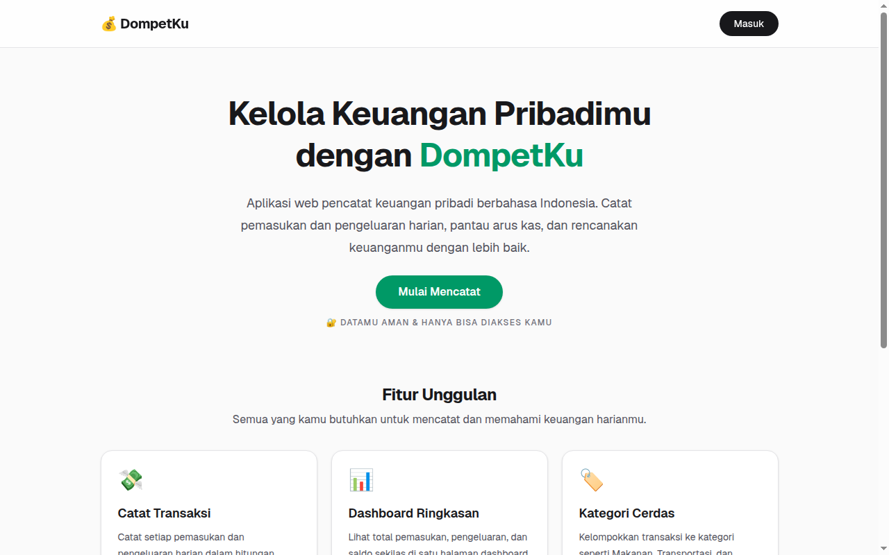

# DompetKu Web

DompetKu adalah aplikasi web pencatat keuangan pribadi berbahasa Indonesia. Pengguna mencatat pemasukan dan pengeluaran, memantau dashboard, mengatur budget per kategori, dan mengelola pemasukan rutin. Data yang sama juga dipakai aplikasi Flutter DompetKu lewat REST API publik dengan akun yang sama.

Situs live: https://dompetku.bintangyudhis.my.id

## Fitur

- Registrasi dan login dengan email dan kata sandi memakai NextAuth dan sesi JWT.
- Dashboard berisi saldo, total pemasukan dan pengeluaran bulan berjalan, grafik arus kas 30 hari, dan analisa pengeluaran per kategori.
- Tambah, ubah, dan hapus transaksi dengan filter tipe, kategori, dan rentang tanggal, plus pencarian catatan.
- Kategori pemasukan dan pengeluaran yang bisa dikelola sendiri. Kategori bawaan dibuat otomatis untuk akun baru.
- Shortcut cepat untuk mencatat pengeluaran rutin dalam satu klik.
- Budget per kategori per bulan dengan indikator pemakaian dan peringatan saat mendekati batas.
- Template pemasukan rutin yang bisa diterapkan ke bulan berjalan tanpa tercatat ganda.
- Ekspor dan impor transaksi dalam format CSV. Ekspor mengikuti filter yang aktif dan impor membuat kategori baru secara otomatis bila belum ada.
- Mode gelap dengan pilihan yang tersimpan di perangkat.
- REST API publik di `/api/public` untuk aplikasi mobile. Login dan registrasi mengembalikan token sesi Bearer. Endpoint tersedia untuk ringkasan, transaksi, dan kategori.

## Teknologi

- Next.js 16 dan React 19 dengan App Router
- TypeScript
- Tailwind CSS v4
- Prisma 6 dan PostgreSQL dari Supabase lewat connection pooler
- NextAuth v4 dan bcryptjs untuk autentikasi web
- jose untuk token JWT pada API publik
- Recharts untuk grafik dashboard

## Cara Instalasi

Prasyarat:

- Node.js 20 atau lebih baru
- Database PostgreSQL, misalnya project Supabase

Langkah instalasi:

```bash
git clone https://github.com/bintangyudhis/dompetku-web.git
cd dompetku-web
npm install
cp .env.example .env
```

Isi nilai variabel berikut di berkas `.env`:

- `DATABASE_URL`
- `DIRECT_URL`
- `NEXTAUTH_SECRET`

Lalu jalankan migrasi database:

```bash
npx prisma migrate deploy
```

## Cara Menjalankan

Mode pengembangan:

```bash
npm run dev
```

Buka http://localhost:3000 di browser.

Mode produksi:

```bash
npm run build
npm start
```

Perintah `npm run build` menjalankan migrasi database lebih dulu, lalu membangun aplikasi. Pemeriksaan kode memakai `npm run lint`.

## Tangkapan Layar



## Lisensi

Proyek ini memakai lisensi MIT. Lihat berkas [LICENSE](LICENSE).
